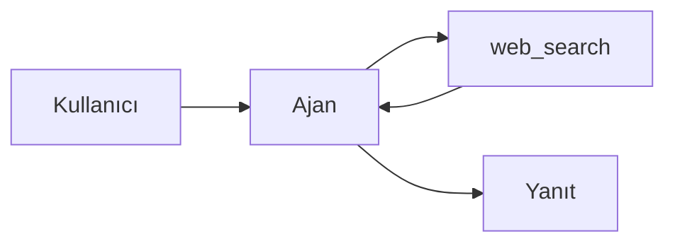

# Mesaj İçeriği Bileşeni

`MessageContent.svelte` bileşeni, ajan ve kullanıcı mesajlarını düz metin yerine zengin içerik olarak render eder. Markdown, HTML, Mermaid diyagramları ve JSON için özel işleme uygular.

---

## Desteklenen İçerik Türleri

### Markdown

Standart GFM (GitHub Flavored Markdown) desteklenir: başlıklar, listeler, tablolar, blockquote, kalın/italik, satır içi kod ve bağlantılar.

````markdown
## Satış Özeti

| Ay  | Gelir  |
|-----|--------|
| Oca | 142K   |
| Şub | 158K   |

> Q1 toplamı beklentileri **%12** aştı.
````

---

### Kod Blokları

Her kod bloğu dil rozeti ve tek tıkla kopyalama butonu içerir.

````markdown
```python
def hesapla(x):
    return x * 2
```
````

Render edilen çıktı:

```
┌─────────────────────────────────┐
│ python          [Kopyala]       │
├─────────────────────────────────┤
│ def hesapla(x):                 │
│     return x * 2                │
└─────────────────────────────────┘
```

**Kopyala** butonuna basıldığında kod panoya alınır; buton 1,8 saniye "Kopyalandı!" yazar, ardından eski haline döner.

---

### JSON — Otomatik Formatlama

İki durumda JSON özel olarak işlenir:

1. Mesaj içindeki ` ```json ` kod bloğu
2. Mesajın tamamı `{` veya `[` ile başlıyorsa (ham JSON tespiti)

Her iki durumda da JSON `JSON.stringify(..., null, 2)` ile güzel biçimlendirilir ve yeşil tonlu `json` bloğu içinde gösterilir.

```json
{"siparis_id":"ord-001","tutar":2400,"durum":"onaylı"}
```

Şu şekilde render edilir:

```json
{
  "siparis_id": "ord-001",
  "tutar": 2400,
  "durum": "onaylı"
}
```

---

### HTML Önizleme

` ```html ` bloğu hem kaynak kodu hem de katlanabilir önizleme içerir:

````markdown
```html
<h2>Merhaba</h2>
<p style="color:green">Bu bir önizlemedir.</p>
```
````

Kaynak kod görüntülenir; "HTML Önizleme" detay satırına tıklanınca tarayıcı render'ı açılır.

:::caution Güvenlik
HTML içeriği DOMPurify ile sanitize edilir. Tehlikeli script ve event handler'lar kaldırılır.
:::

---

### Mermaid Diyagramları

` ```mermaid ` bloğu Mermaid.js ile otomatik SVG'ye dönüştürülür.

````markdown

````

Render sırasında spinner gösterilir; SVG hazır olduğunda yerleştirilir. Hata durumunda kaynak kod düz metin olarak görüntülenir.

Diyagram teması arayüzün koyu/açık moduna otomatik uyar.

---

## Render Boru Hattı

```
content (string)
    │
    ├─ Ham JSON? ──→ JSON bloğu (biçimlendirilmiş)
    │
    └─ Değil? ──→ marked.parse()  (GFM + özel renderer)
                        │
                   DOMPurify.sanitize()
                        │
                   {@html rendered}
                        │
              ┌─────────┴──────────┐
        Mermaid blokları     Copy butonları
        (lazy Mermaid.js)    (click handler)
```

---

## Streaming Desteği

`streaming` prop'u `true` olduğunda bileşen "yazıyor" moduna geçer. Her yeni metin parçası geldiğinde `$effect` tetiklenir ve render yeniden hesaplanır.

```svelte
<MessageContent content={streamingText} streaming={true} />
```

---

## Bağımlılıklar

| Kütüphane | Kullanım |
|---|---|
| `marked` | Markdown → HTML dönüşümü (GFM) |
| `dompurify` | HTML sanitizasyonu (lazy yüklenir) |
| `mermaid` | Diyagram render (lazy yüklenir) |

Her üç kütüphane `onMount` veya `import()` ile istemci tarafında lazy yüklenir; SSR sırasında çalıştırılmaz.

---

## İlgili Belgeler

- [İşler Sayfası](./chat-ui.md)
- [Agent Runtime](./agent-runtime.md)
