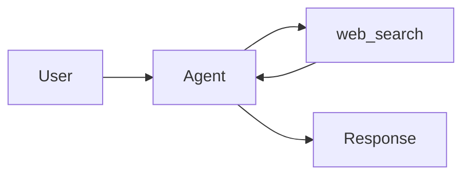

# Message Content Component

The `MessageContent.svelte` component renders agent and user messages as rich content rather than plain text. It applies custom processing for Markdown, HTML, Mermaid diagrams, and JSON.

---

## Supported Content Types

### Markdown

Standard GFM (GitHub Flavored Markdown) is supported: headings, lists, tables, blockquotes, bold/italic, inline code, and links.

````markdown
## Sales Summary

| Month | Revenue |
|-------|---------|
| Jan   | 142K    |
| Feb   | 158K    |

> Q1 total exceeded expectations by **12%**.
````

---

### Code Blocks

Each code block includes a language badge and a one-click copy button.

````markdown
```python
def calculate(x):
    return x * 2
```
````

Rendered output:

```
┌─────────────────────────────────┐
│ python          [Copy]          │
├─────────────────────────────────┤
│ def hesapla(x):                 │
│     return x * 2                │
└─────────────────────────────────┘
```

When the **Copy** button is clicked, the code is copied to the clipboard; the button displays "Copied!" for 1.8 seconds, then reverts to its original state.

---

### JSON — Auto Formatting

JSON is processed specially in two cases:

1. A ` ```json ` code block inside the message
2. The entire message starts with `{` or `[` (raw JSON detection)

In both cases, the JSON is pretty-printed using `JSON.stringify(..., null, 2)` and displayed inside a green-toned `json` block.

```json
{"order_id":"ord-001","amount":2400,"status":"approved"}
```

Is rendered as:

```json
{
  "order_id": "ord-001",
  "amount": 2400,
  "status": "approved"
}
```

---

### HTML Preview

A ` ```html ` block includes both the source code and a collapsible preview:

````markdown
```html
<h2>Hello</h2>
<p style="color:green">This is a preview.</p>
```
````

The source code is displayed; clicking the "HTML Preview" detail row opens the browser-rendered view.

:::caution Security
HTML content is sanitized with DOMPurify. Dangerous scripts and event handlers are removed.
:::

---

### Mermaid Diagrams

A ` ```mermaid ` block is automatically converted to SVG using Mermaid.js.

````markdown

````

A spinner is shown during rendering; the SVG is inserted once ready. On error, the source code is displayed as plain text.

The diagram theme automatically adapts to the interface's dark/light mode.

---

## Render Pipeline

```
content (string)
    │
    ├─ Raw JSON? ──→ JSON block (formatted)
    │
    └─ No? ──→ marked.parse()  (GFM + custom renderer)
                    │
               DOMPurify.sanitize()
                    │
               {@html rendered}
                    │
          ┌─────────┴──────────┐
    Mermaid blocks       Copy buttons
    (lazy Mermaid.js)    (click handler)
```

---

## Streaming Support

When the `streaming` prop is `true`, the component enters "typing" mode. Each time a new text chunk arrives, `$effect` is triggered and the render is recalculated.

```svelte
<MessageContent content={streamingText} streaming={true} />
```

---

## Dependencies

| Library    | Usage                                      |
|------------|--------------------------------------------|
| `marked`   | Markdown → HTML conversion (GFM)           |
| `dompurify` | HTML sanitization (lazy loaded)           |
| `mermaid`  | Diagram rendering (lazy loaded)            |

All three libraries are lazy-loaded on the client side via `onMount` or `import()`; they are not executed during SSR.

---

## Related Docs

- [Jobs Page](./chat-ui.md)
- [Agent Runtime](./agent-runtime.md)
